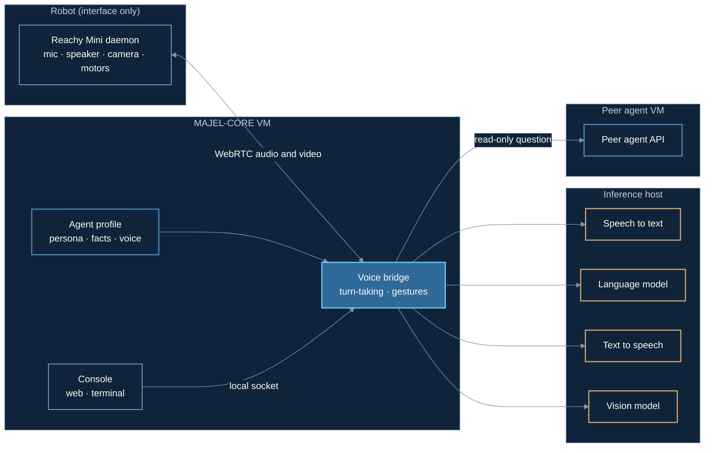

# 0001: Reachy Mini as a voice interface for a remotely hosted agent

- **Status:** Complete
- **Dates:** 2026-10-08 to 2026-10-21
- **Related decision:** [ADR-0001](../decisions/0001-reachy-embodiment-adapter.md)

## Hypothesis

A Reachy Mini Wireless can act purely as an interface (microphone, speaker, camera and motors) for an agent whose speech recognition, language model and speech synthesis all run on a separate inference host on the same LAN. Specifically:

1. A spoken reply can start within 2 seconds of the user stopping talking, using only local models.
2. The robot needs no agent credentials, and the agent's identity (persona, memory) can live entirely outside the robot and the inference host.
3. The same bridge can consult a peer agent for information it doesn't hold, receiving results, not the peer's credentials.

## Architecture / configuration

Each box is a separate host or VM, and so a separate trust boundary.

| Component | Version / model |
|---|---|
| Robot | Reachy Mini Wireless, `reachy-mini` SDK 1.11.0, network connection mode, WebRTC media backend |
| WebRTC on the bridge host | GStreamer 1.24 with `webrtcsrc` from gst-plugins-rs 0.14.5 (built from source with cargo-c) |
| Bridge host | MAJEL-CORE: Ubuntu 24.04 Hyper-V VM, 4 vCPUs, about 2 GB dynamic RAM |
| Speech to text | faster-whisper `base.en` behind an OpenAI-compatible `/v1/audio/transcriptions` |
| Language model | Ollama, `qwen3:4b-instruct-2507` (Q4_K_M), OpenAI-compatible chat completions with streaming |
| Text to speech | Kokoro, OpenAI-compatible `/v1/audio/speech`, raw 24 kHz PCM |
| Vision | A 27B multimodal model on vLLM when available; `qwen2.5vl:7b` on Ollama as fallback |
| Peer agent | Hermes Agent API server, LAN-only, bearer-token auth, firewall restricted to the bridge host |

Inference endpoints required no key and were reachable only on the LAN. The agent profile (persona, standing facts, peer-agent key) lived in the operator's private config directory on MAJEL-CORE, not in this repository and not on the robot or inference host.

## Procedure

1. Confirmed robot motion from the bridge host (enable torque, wake, nod, sleep).
2. Built the GStreamer WebRTC source plugin and verified two-way audio: played a tone through the robot and recorded the room.
3. Brought up speech to text, the language model and text to speech on the inference host as OpenAI-compatible services.
4. Wrote the bridge: energy-based voice activity detection against a tracked noise floor, half-duplex turn-taking (mic ignored while speaking plus a 0.4 s echo guard), sentence-by-sentence streaming from the language model into synthesis, and gestures on a separate thread.
5. Added name-gating with a 20-second follow-up window, and spoken sleep/wake commands.
6. Added a `consult peer` tool. Requests to the peer were framed as read-only lookups; keyword routing in code backed up the model's own tool calls.
7. Added on-request vision (one frame per question, kept in memory only) and the robot daemon's built-in face tracking.
8. Ran it as a systemd user service, then added a local control socket and a web/terminal console for settings and live control.

## Measurements

Latency is from the end of the user's speech (as detected by the bridge) to the first audio sample queued to the robot.

| Measurement | Result |
|---|---|
| First reply audio, conversation turns | 0.87–1.73 s (typical about 1.0 s) |
| Speech-to-text time per utterance (`base.en`) | 0.46–0.63 s |
| Language model, first token (4B, model already loaded) | under 0.5 s; 3.9 s when Ollama had to reload it |
| Language model, 27B on vLLM | first token about 0.45 s, then about 7 tokens/s |
| Vision answer, 27B on vLLM | 2.5 s for a short description |
| Vision answer, 7B on Ollama | 2.9 s cold, 0.3 s warm |
| Peer-agent round trip, short question | about 6 s |
| Bridge CPU, camera on | 104% of one vCPU (20 s sample) |
| Bridge CPU, camera off (video track discarded) | 57% of one vCPU |
| Rate at which the 4B model called the peer tool when it should have | roughly 25–50% |

## Observations

- With small local models, the loop met the 2-second target comfortably. Most of the budget went to speech recognition and the first synthesized sentence; streaming sentence by sentence mattered more than model speed.
- The 27B model starts quickly but generates slowly, so it suits short vision answers better than conversation.
- Name-gating was necessary: a television in the room otherwise produced replies.
- On silence, Whisper sometimes returned its own vocabulary hint (the agent's name) as a transcript, which could have woken the agent. The bridge now ignores transcripts that are only the name.
- The robot's daemon provides face tracking that runs on the robot itself, costing the bridge host nothing.
- The 4B model often embellished or invented details about its own setup; explicit rules against this in the system prompt helped only partly.
- The peer agent's API exposes its full toolset, including a terminal. Its email access works through terminal commands, so "read-only" framing either blocks email entirely (if terminal use is forbidden) or relies on the peer following instructions (if allowed). The IMAP account behind it is read-write.
- The inference host is shared. When a large vLLM instance was resident, only about 29.5 GiB remained for Ollama, and a 48 GiB vision model could not load.

## Failures

- **Robot didn't move on the first motion test, although no errors were reported.** `wake_up()` does not enable torque; `enable_motors()` must come first. Success was initially reported on the absence of errors, which was wrong.
- **WebRTC media unavailable.** The SDK needs GObject introspection typelibs and the Rust `webrtcsrc` element, which Ubuntu 24.04 doesn't package. Building gst-plugins-rs took about 7 minutes on two cores.
- **First audio pushed too early.** The WebRTC send chain becomes ready about 4 s after connecting; audio pushed earlier is lost.
- **Garbled replies.** The streaming response has no charset, so the HTTP client decoded UTF-8 as Latin-1.
- **15-second utterances.** Background noise that started after calibration kept speech "open". Fixed by judging end of speech against the level just before the utterance and against the speaker's own loudness. Speaking within 15 s of a TV starting still merges the two.
- **Silent hang after the robot dropped the connection.** The service stayed "active" for two days without audio. The bridge now exits when the mic is silent for 10 s, and systemd restarts it.
- **Motor clicking while asleep.** The bridge re-sent the resting pose on every unrecognized sound. Repeated poses are now skipped.
- **Peer agent refused email lookups** under the read-only framing, for the reason described in Observations. Unresolved.
- **Camera-off CPU saving smaller than expected.** Discarding the video track after `webrtcsrc` still leaves the decode inside it.

## Conclusions

- **Hypothesis 1: supported** with high confidence for short conversational turns on a quiet-to-moderate room. Latency was dominated by speech recognition and synthesis, not by the language model.
- **Hypothesis 2: supported.** The robot held no agent credentials, and the persona, facts and voice choice lived in a private profile on MAJEL-CORE. The bridge and its console are generic once that profile is separated out.
- **Hypothesis 3: partly supported.** The bridge received results, not the peer's credentials. However, the bridge itself held a bearer token for the peer's full-authority API, and the read-only restriction existed only as an instruction. That is exactly the gap MAJEL's policy layer is meant to close.

## Resulting architectural changes

- [ADR-0001](../decisions/0001-reachy-embodiment-adapter.md) (proposed): the bridge becomes a generic Reachy adapter in `adapters/reachy/`, with agent identity in a separate private profile.
- Agent-to-agent calls from the adapter should move behind MAJEL routing and policy, so that authority limits are enforced rather than requested. Not yet designed.
- The adapter's backend settings (speech to text, language model, text to speech, vision, each with a fallback) are an early, hand-built form of capability routing. They should be replaced by `majel/capabilities` once it exists.
